# The game with its contents removed

*A draft. Every number is checked; the voice is yours to replace.*
*The previous draft is kept at `BLOGPOST.v1.md`.*

---

There is a mobile RPG from 2005 called Era of Eidolon. You can download it
right now — a dozen copies are scattered across abandonware sites and old
phone-game archives. It installs. It shows a title screen with a wizard and
two skulls. You press Start Game, and you stand in an empty world.

Not a broken one. An empty one. The ground is there, the trees are there,
the water is there. There is nobody in it, nothing to pick up, and the doors
go nowhere.

The jar on your phone was never the game. It carried the pictures. The world
— every monster and where it stood, every door and where it led, every chest,
every trigger, the whole quest — came down a wire from a server that stopped
answering.

This is what it took to find it again.

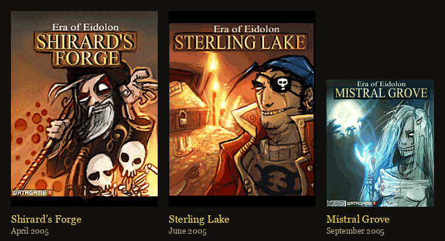

---

## Who made it

watAgame. The Java package name is still in every jar:

    com.watAgame.eoe_town.EoETown

Eighteen jars survive that I could find, and J2ME jars carry a build date, so
their manifests give the shape of the thing:

    2004-10-26   Orumant            v5.2.8     trial
    2004-11-24   Orumant            v5.2.10
    2005-03-06   Badaz Blackjack    v1.0.0
    2005-03-21   Dagonar            v5.3.3
    2005-04-29   Shirard's Forge    v1.0.0     the first chapter
    2005-05-24   Shirard's Forge    v1.1.0
    2005-06-03   Sterling Lake      v1.1.1
    2005-06-09   Badaz Poker        v1.0.2
    2005-09-27   Mistral Grove      v1.1.7
    2005-10-25   Dagonar            v5.4.3

Those eighteen jars are eleven copies of the three chapters, four of the two
Arena towns, and three of the card games — the same release packaged for
different handsets.

### Version 5 before version 1

Orumant and Dagonar are at **version 5** in 2004. Shirard's Forge starts at
**1.0.0** in 2005. These are not one product maturing. They are two games,
and the duelling one came first.

---

## Three kinds of jar

Not every copy of a chapter is the same. Sort them by what they carry and
three kinds fall out.

    thin  (MIDP 1.0)       4 resources,  0 tilemaps
    data-local            66–77 resources, 17–18 tilemaps
    fully offline         76 resources, including the world itself

The **thin** builds are for the oldest handsets. They ship four files and
download everything else as they run — the entire world, a room at a time.

The **data-local** builds are the common ones. The art is in the jar; the
world still is not.

And then there is the third kind.

---

## Finding the world

Two resources never shipped. The client calls them type 1 and type 9: the
placed entities — doors, triggers, chests, the quest machine — and the
creature table, every monster and the square it stands on. Everything else
is local. Those two came down the wire.

So the only way to find them was to list the resources of all eleven chapter
jars and look for a name nothing else had. Two turned up, in one file:

    EoE-ShiradsForge-v1.0.0-midp1.jar      63 KB    4 resources   nothing
    EoE-ShiradsForge-v1.0.0-176x208.jar   151 KB   76 resources   EVERYTHING

Same version. Same day — 29 April 2005. Two packagings of one release, and
only the one cut for Nokia's larger screen carries the world:

    235 entities across 18 locations
    111 creature nodes

### Does it hold up?

Every entity's box falls inside its own map. Every exit's arrival square
falls inside its destination. All 111 creatures stand on ground, and every
creature id is a sprite the jar already has. The tilemaps of that build are
the same size, room for room, as the later release — so the tables drop
straight into the version people actually played.

Sterling Lake and Mistral Grove have no such build. Everything I say about
them later is a guess with the arithmetic shown.

---

## What the tables said

**The Crypt is not a small room.** You walk into a cross-shaped room — 53
floor tiles, two ghosts. By the end it is 147 tiles. Each wave arrives with a
patch of new floor painted in under it, and the creatures standing there wake
at the same moment. Twenty-two entities for one fight, where a normal room
has two or three.

**The doors are load boundaries.** Most sit on a map's edge and meet their
partner on the opposite edge of the next map, so the rooms tile flat into one
continuous world. Fourteen shared borders, and every room sits on the real
coordinates its own doors give it:

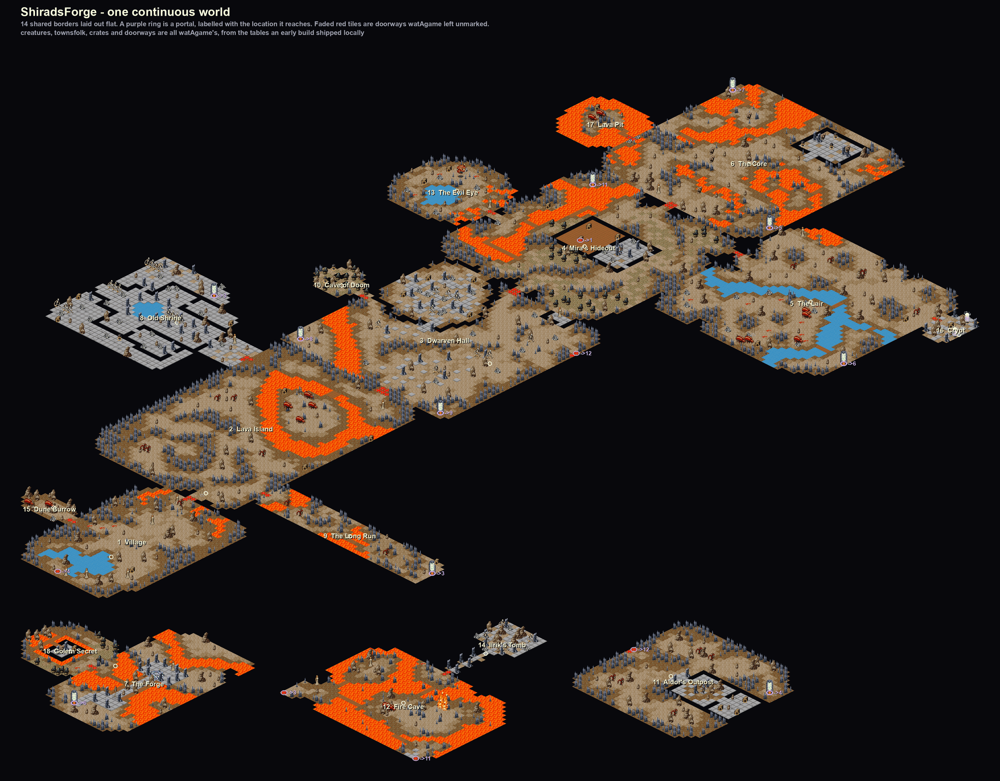

It does not come out as one continent, and that is the honest result. Thirteen
rooms lock together into the mass at the top. The Forge and Golem Secret make a
pair of their own; so do Fire Cave and Ilrik's Tomb; Aldor's Outpost stands
alone. Those four islands are joined to each other by doors in the *middle* of
a map rather than on an edge — a portal, not a shared border — and a portal
carries no information about where the next room lies.

So the three small islands are simply shelved under the big one to keep the
picture from running off the side. That arrangement means nothing. What does
mean something is the shape *inside* each island: every room there sits on the
coordinates its own doorways force, and each island is moved as a single rigid
piece, so not one seam is bent to make it fit.

We did try. For a while three of those rooms were turned a quarter clockwise
and a bridge was laid across Fire Cave's lava, and the chapter did seam into
one satisfying picture. It was also a lie: watAgame had already joined Fire
Cave to Aldor by a door in the south-east corner, and the turn moved that door
and then needed the bridge to repair what it had moved. The picture was the
only thing it bought. It is reverted. Every tile, door and creature square
above is the 2005 jar's, and the gaps are part of what was recovered.

**Eleven creatures start asleep.** A `kind 5` entity — one of the placed
entities, a switch rather than a thing — turns them on. Among them: the final
boss, the Crypt's second and third waves, and a twin standing on a boss's own
square, which turns out to be her second phase, written as a separate
creature rather than a flag on the first.

---

## Inside Shirard's Forge

Eighteen rooms around a volcano. The whole chapter is one errand: a wizard
named Shirard has diverted the lava streams, and three cogwheels, hidden
across the map, will put them back.

    Lava Island     a crate   cogwheel 1 of 3
    Dwarven Hall    a crate   cogwheel 2
    Mira's Hideout  a boss    she tells you where the third is
    The Lair        a crate   cogwheel 3
    The Forge       the statue, and what is behind it

You can walk into the Forge at any point and open the hatch at the statue's
base. The game tells you: *"Obviously you don't have all cogwheels yet!"*
Fit all three and the mechanism turns, the lava reverts, and the statue
topples into it — at which point Shirard appears, who until that moment did
not exist in the room at all:

> *"You fool! … You have destroyed my statue… my dream… and for that you
> shall die!"*

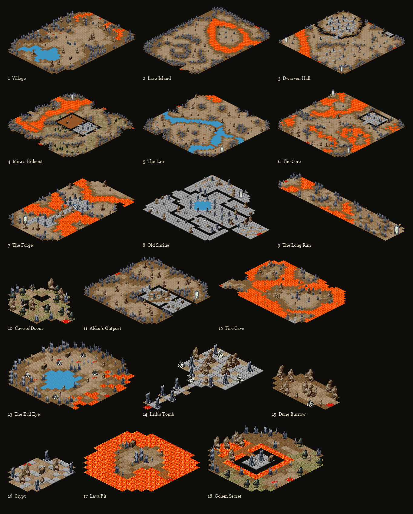

### The quest log

Eleven of them, and reading the list is the fastest way to see what the
chapter is:

    Rescue Hrom from the Gorrak
    Find lever to extend bridge
    Seek out Mira
    Find 1st cogwheel
    Find 2nd cogwheel
    Find 3rd cogwheel
    Restore lava stream
    Defeat Shirard
    Clear the Shrine of undead
    Return gem from fire devils to Tillic
    Slay the Beholder

Eight are the spine. The last three — the shrine, the gem, the beholder — are
the side of the map you never have to visit.

---

## Three things I got wrong

A reconstruction post that only lists the wins is not worth much. These three
cost real time, and two of them are the same mistake.

### The patrol box

Four bytes on each creature row, and they climb with depth. Read as two
pairs, the same Beetle is `12, 6` in the first cave and `32, 33` in the last.
That is obviously a difficulty curve, and I built a combat system on it:
damage, accuracy, avoidance and spell resistance, all derived from those four
numbers.

They are the corners of a rectangle. `x0, y0, x1, y1` — the patch of ground
the creature wanders while you explore.

What gave it away was finally running the null test. All sixty-nine creatures
that carry those bytes stand *inside* their own rectangle. The typical
rectangle covers a tenth of its map; averaged over all of them, a random tile
lands inside one about a quarter of the time. Sixty-nine out of sixty-nine is
not a coincidence at any odds worth writing down.

The correlation with depth was real. It just meant nothing — deeper maps are
bigger, so their coordinates are bigger.

### State 3 means gone

Having worked out that eleven creatures should start asleep, I marked them
not-alive and shipped it. The client takes a byte per creature: **1 means it
exists but is not drawn, 2 means it is on the board, 3 means it is gone.**

I was sending 3. The final boss would never have appeared, and the Crypt's
waves would never have come. The distinction is documented in the function I
was editing, three lines above the line I changed.

### Byte 11

The creature row has a byte that reads 18 for a skeleton, 24 for a gorrak,
30 for a beetle, 50 for a fungusman. Hit points, clearly — the ordering is
exactly what you would expect, and it survived months of being treated that
way.

It is the respawn timer. The client reads it in three places and every one is
a countdown: a dead creature with a non-zero value is revived on load, death
copies it into a counter, and a tick every ten seconds decrements it until
the creature comes back. Zero means a fight that never returns; fifty means
about eight minutes.

Hit points were the server's, like everything else.

That is twice I read a server-side *timing* field as a *combat stat*, with
the same confidence both times, for the same reason: the numbers were ordered
the way I expected combat numbers to be ordered.

---

## How a fight works

None of this came from the server. The fight rules were in the jar all along,
which is why this is the one part of the game that can be read rather than
rebuilt.

### The 720

A turn is **720**. Not seconds, not frames — a budget, and every action
spends some of it.

    a step            40
    a blow            what your weapon weighs: 96 for the starting sword,
                      240 for the heaviest hammer
    a dodge           20
    a healing spell  150

So a light sword gets you five swings a turn and a hammer gets you two.

### The clock runs while you think

This is the client's own code:

```java
if (this.c) {                                       // in a fight
    n = (this.t - this.ax) / 1000L;                 // whole seconds elapsed
    this.ag += n * 5;                               // five units per second
    if (this.ag > 720) { this.j(); this.ag = 720; } // and the turn ends itself
}
```

**The clock you spend on walking and swinging is the same clock that empties
while you think.** Five units for every real second you sit looking at the
screen. 720 ÷ 5 = 144 seconds. Two minutes and twenty-four, and then the turn
goes without you.

A swing of the starting sword costs 96 — the same as nineteen seconds of
deliberation. Lift the heaviest hammer and one blow costs what forty-eight
seconds of thinking costs.

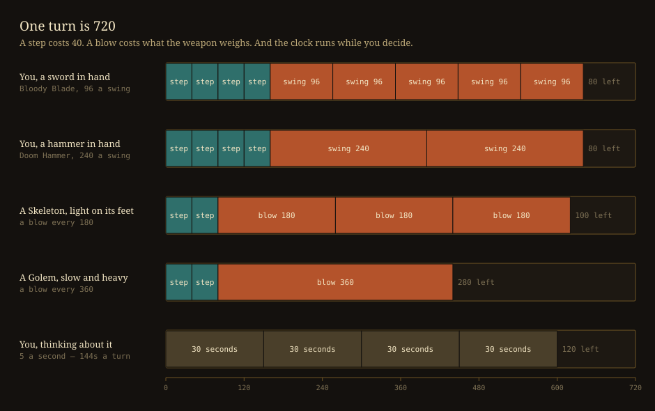

You commit the whole turn blind, the creature commits its whole turn, and the
two are merged and played in time order. You are never reacting — you are
predicting.

---

## What the client knows about itself

### The bar along the bottom

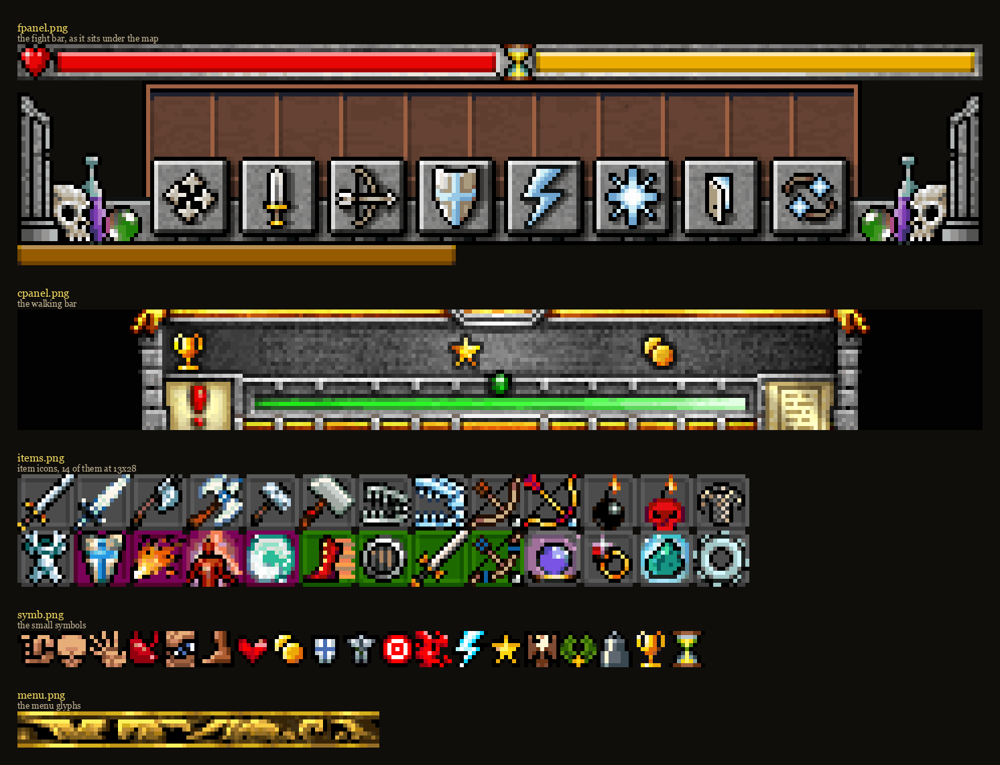

Two bars run across the top of a fight. The red one with the heart is your
life. The gold one beside the hourglass is the turn — the same 720 — draining
as you spend it, which is the only warning you get that you have been
thinking too long.

Below that, eight buttons:

    four arrows     walk           40 a square
    sword           strike         what your weapon weighs
    bow             shoot          needs a clear line, and never in contact
    shield          defend         20, and it lasts the turn
    lightning       attack magic   60, ignores armour, no roll to hit
    starburst       ward magic     40 or more, depending on the ward
    door            flee           ends the fight where you stand
    two arrows      end the turn   hand the rest of the clock back

The two the client owns outright are flee and end-turn. The other six are
slots the server filled, so the exact spell behind each icon depended on what
you had learnt.

When you are not fighting the bar changes: a trophy, a star, your purse, a
sliver of experience, and the book that opens your quests.

### What you can carry

Every piece of gear is one of five kinds, and the game tells you which by the
colour behind its icon:

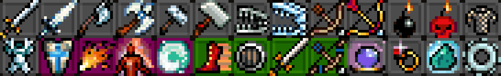

Twenty-eight icons — swords, axes, hammers, bows, bombs and suits along the
top; spells, skills and charms below.

The statistics behind them survive because the Arena's remake carries them. A
weapon's **time** is what one swing costs of the turn, which is the whole of
the difference between a sword and a hammer:

    Bloody Blade    sword    time  96    the one you start with
    Giant Sword     sword    time 120
    Ghost Sword     sword    time 126
    Spike Axe       axe      time 195
    Smasher         hammer   time 211
    Doom Hammer     hammer   time 240

---

## What is ours

The reconstruction is only worth something if it says where it stopped
knowing. Separated deliberately:

**The numbers.** Hit points, prices, gold, experience and the entire shop
were the server's. What survives is the Arena's item catalogue — 203 entries
with real times, effects, prices and ability requirements — and the client's
own action costs. Everything else is fitted.

**The balance.** That catalogue was written for the Arena, where a duellist
reaches level 49 and item requirements run to 78. A chapter hero fights his
way through eighty-seven creatures and finishes somewhere around level 12, so
most of the list is unreachable. The chapter now sells a slice, respread over
the range a chapter hero actually covers.

**The fight.** Creatures threaten a *shape* rather than every square around
them — a skeleton one square ahead, a golem three, the beholder its four
corners, a fungusman four squares at arm's length and none at all beside it.
They swing at a speed set by their weight. None of this is watAgame's; their
creatures all hit the same way.

**The hero.** The rules say every ability starts at 15. That is the Arena's
number. Here they start at 3 — the lowest requirement any item asks for — so
there is room to level up into the catalogue.

**Not the world, though.** Every tilemap, door, creature square, quest and
line of dialogue in this post came out of the jar. Three rooms spent a week
turned a quarter clockwise so the map would seam into one picture; that is
reverted, and what you see above is the shape watAgame shipped.

---

## The other half: the Arena

Before the chapters there was the gladiator game.

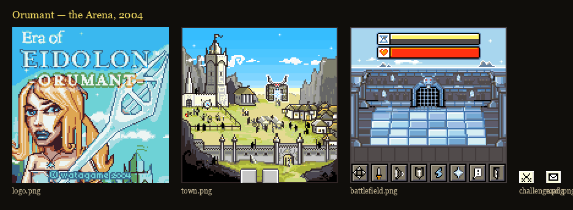

A town you walk around, an arena you fight in, a mailbox, a clan. Your
character is assembled from parts — a torso, legs, a weapon — so the armour
you buy is drawn onto you:

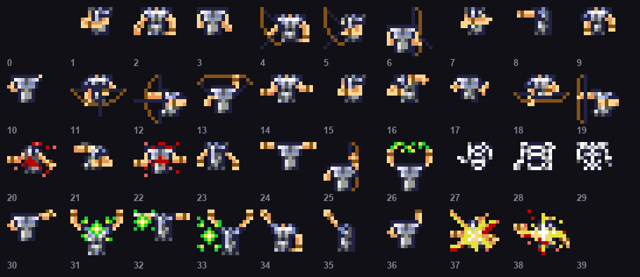

### The generation is in the URL

The chapters speak a binary protocol: a two-byte magic number `0xBABE`, then
records of `tag, type, length`, twenty-eight message types in all. The Arena
does not. It calls CGI scripts by name — and the path says which game you are:

    prod1   the Arena        /1/     named CGI scripts
    prod4   Shirard's Forge  /2/
    prod5   Sterling Lake    /2/
    prod6   Mistral Grove    /2/

The earliest Arena builds have no hostname at all. They point at a bare IP,
`81.7.141.67`, from before someone put names in front of the machines.

Sixty-four endpoint names are recoverable from the constant pool, and they
are byte-identical between Orumant and Dagonar — one server, two towns, and
an API that did not change in the year between them:

    login register charselectcreate herostats equiplist buyitem
    chalissue fightresult battlereport getranklist
    clancreate clanjoin clanhierarchy friendadd inbox sendmail

Clans. Friends lists. A mailbox. Rankings. On a phone, in 2004.

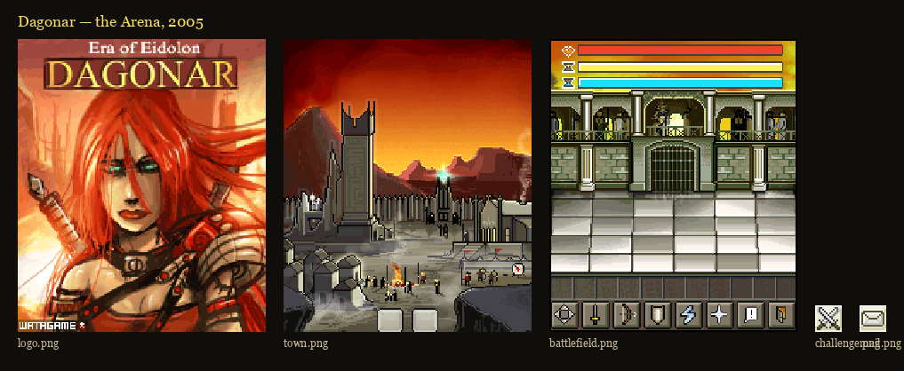

None of this has been rebuilt. This project has only read it.

---

## The two chapters still dark

I can only show these two as a scatter of screenshots. There is no map to
draw: their doorways came from the server with everything else, so **nobody
knows which room joins which.**

**Sterling Lake**, June 2005 — seventeen rooms of water and jetties.
Fishmen, sandleeches, crabs, an aquamental, and a pirate called Black Eye.

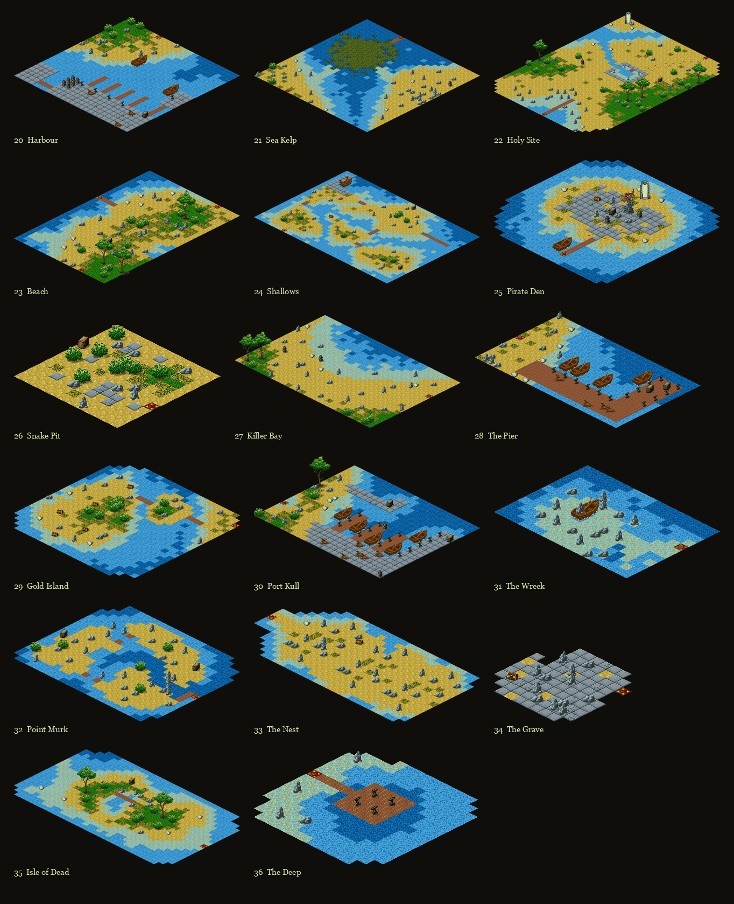

**Mistral Grove**, September 2005 — eighteen rooms of snowbound forest, and
the strangest bestiary of the three: will o' wisps, treemen, reaperweed,
demon dogs, a spider, and a character called Trix. Rooms named Mirror Pool,
Spiderwood, Hollow Hill, Reaperwood.

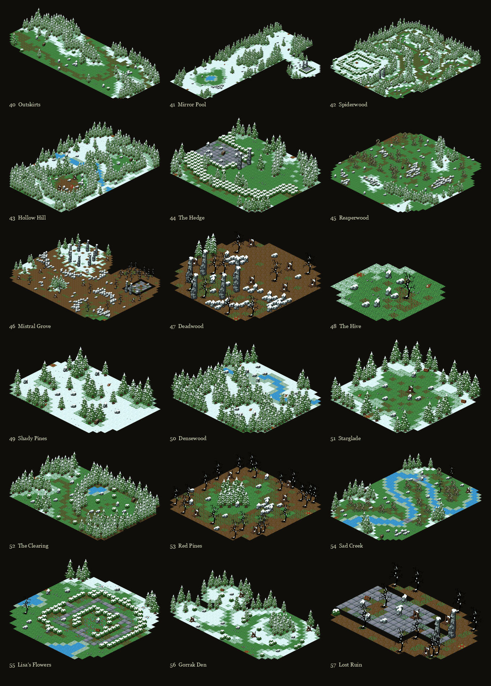

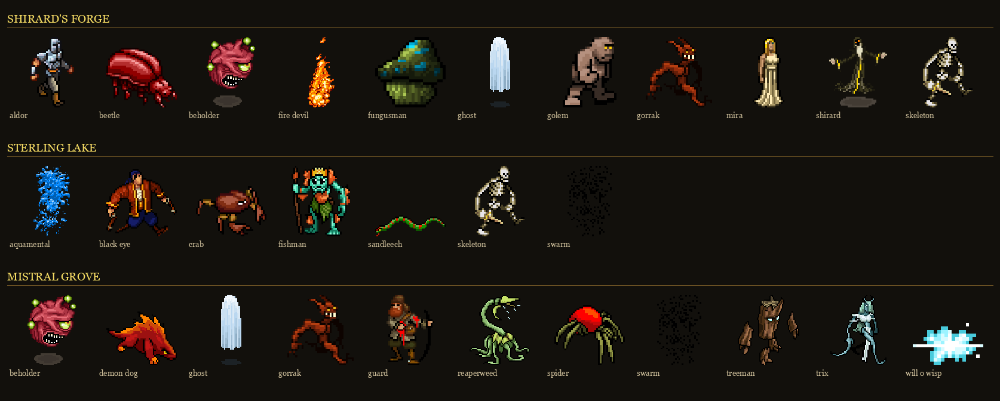

---

## The copies that survive

### A build per phone

In 2005 you shipped a build per handset. Alongside the thin and data-local
cuts there are screen-specific ones — `176x208` for Nokia's Series 60,
`k300` and `k700` for Sony Ericsson.

It is one of those, the Nokia cut of Shirard's Forge, that happens to carry
the world.

### Someone else's name in the manifest

Three of the eighteen jars have been through other hands:

    Badaz Poker by ROADKILL
    Badaz Poker SEfan.RU
    EoE Dagonar -=eViL D:=-

watAgame also shipped two card games in 2005 under that "Badaz" label,
reusing the Era of Eidolon town art for the lobby — and Poker's surviving
copies are the ones carrying the loudest tags.

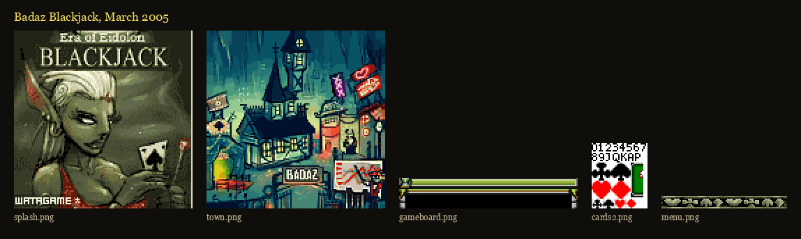

---

## What is still missing

- The entities and creatures for Sterling Lake and Mistral Grove. No offline
  build of either is known.
- The Arena server entirely. Sixty-four endpoints, none implemented.
- A fourth chapter, Ravarcil.
- Four entity kinds we have not decoded, covering nineteen entities.
- When the servers actually went dark. Every jar is dated; nothing I have
  dates the shutdown.

---

*If you played this — in a Danish playground in 2005, or anywhere else — I
would like to hear from you. And if you have a jar I have not listed, I would
very much like to see it.*
