# The game with its contents removed

*A draft. Facts are checked; the voice is yours to replace.*

---

There is a mobile RPG from 2005 called Era of Eidolon. You can download it
right now — a dozen copies are scattered across abandonware sites and old
phone-game archives. It installs. It shows a title screen with a wizard and
two skulls. You press Start Game, and you stand in an empty world.

Not a broken one. An empty one. The ground is there, the trees are there,
the water is there. There is nobody in it, nothing to pick up, nowhere the
doors go.

The jar on your phone was never the game. It carried the pictures. The world
— every monster and where it stood, every door and where it led, every chest,
every trigger, the whole quest — came down a wire from a server in Denmark
that stopped answering somewhere around 2008.

This is what it took to put it back.

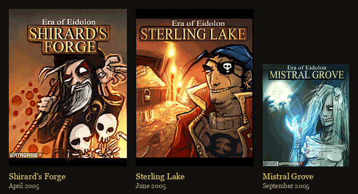

---

## watAgame

A small studio in Copenhagen. They made Era of Eidolon between 2004 and 2008,
and the Java package name in every jar still says who they were:

    com.watAgame.eoe_town.EoETown

Eighteen jars survive that I could find. Their manifests give the shape of the
thing, because J2ME jars carry a build date and a version:

    2004-10-26   Orumant            v5.2.8     trial
    2004-11-24   Orumant            v5.2.10
    2005-03-06   Badaz Blackjack    v1.0.0
    2005-03-21   Dagonar            v5.3.3
    2005-04-29   Shirard's Forge    v1.0.0     the first chapter
    2005-05-24   Shirard's Forge    v1.1.0
    2005-06-03   Sterling Lake      v1.1.1
    2005-06-09   Badaz Poker        v1.0.2
    2005-09-27   Mistral Grove      v1.1.7
    2005-10-25   Dagonar            v5.4.3

Look at the version numbers. Orumant and Dagonar are at **version 5** in 2004.
Shirard's Forge starts at **1.0.0** in 2005. These are not the same product at
different stages — they are two games, and the older one came first.

## Two games, two protocols

**The Arena** came first: Orumant and Dagonar, player-against-player duels in
a gladiator town. MIDP-1.0, five classes, sixteen named PNG files. Its
characters are paper dolls — `torso.png`, `legs.png`, `weapons.png`, `ammu.png`
— composited per fighter, so your armour and your sword are drawn onto you.

It talks to its server by calling CGI scripts **by name**. Sixty-four of them,
recoverable from the constant pool, identical across every Arena build we
have:

    login register betaentry version ping submit pay errorreport
    charselectcreate charselectchoose charselectdelete
    herostats herosksp heroskspdelete incabil pgethead headlist
    equiplist equipdo buyitem sellitem selllist ilistbuy
    chalissue chalreceive flee fightresult battleping battlereport
    arenachflist arenachslist arenachtlist arenachran getranklist
    clancreate clanedit clanjoin clanleave clankick clanlist
    claninvite clanreject clanhierarchy clanstats myclan
    friendadd friendlist friendremoved invite
    inbox readmail sendmail deletemail mailflist pmessages

Clans. Friends lists. A mailbox. Rankings. On a phone, in 2004.

**The chapters** came second: Shirard's Forge, Sterling Lake, Mistral Grove.
MIDP-2.0, isometric, single-player. They speak a binary protocol instead — a
two-byte magic number `0xBABE`, then records of `tag, type, length`, twenty-eight
message types in all.

And the thing I like most: the generation is in the URL.

    prod1   the Arena        /1/     named CGI scripts
    prod4   Shirard's Forge  /2/     binary
    prod5   Sterling Lake    /2/
    prod6   Mistral Grove    /2/

The earliest Arena builds don't even have a hostname. They point at
`81.7.141.67`, a bare IP at a Danish host, from before someone put names in
front of the machines.

---

## The games

### Shirard's Forge (April 2005)

Eighteen rooms around a volcano. The whole chapter is one errand: a wizard
named Shirard has diverted the lava streams, and three cogwheels, hidden
across the map, will put them back.

    Lava Island     a crate   cogwheel 1 of 3
    Dwarven Hall    a crate   cogwheel 2
    Mira's Hideout  a boss    she tells you where the third is
    The Lair        a crate   cogwheel 3
    The Forge       the statue, and what is behind it

You can walk into the Forge at any point and open the hatch at the statue's
base. The game tells you: *"Obviously you don't have all cogwheels yet!"*
Fit all three and the mechanism turns, the lava reverts, and the statue
topples into it — at which point Shirard appears, who until that moment did
not exist in the room at all, and says *"You fool! … You have destroyed my
statue… my dream… and for that you shall die!"*

Its eighteen rooms are a volcano: lava rivers, black rock, a drowned crypt.

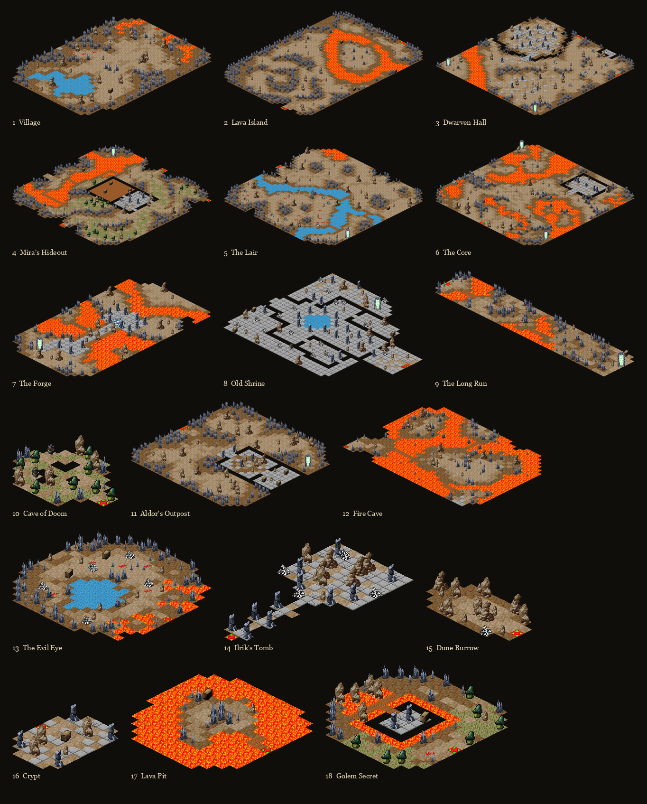

### Sterling Lake (June 2005)

Seventeen rooms, and a wholly different palette — water, jetties, a sunken
look. Fishmen, sandleeches, crabs, an aquamental, and a pirate called Black
Eye.

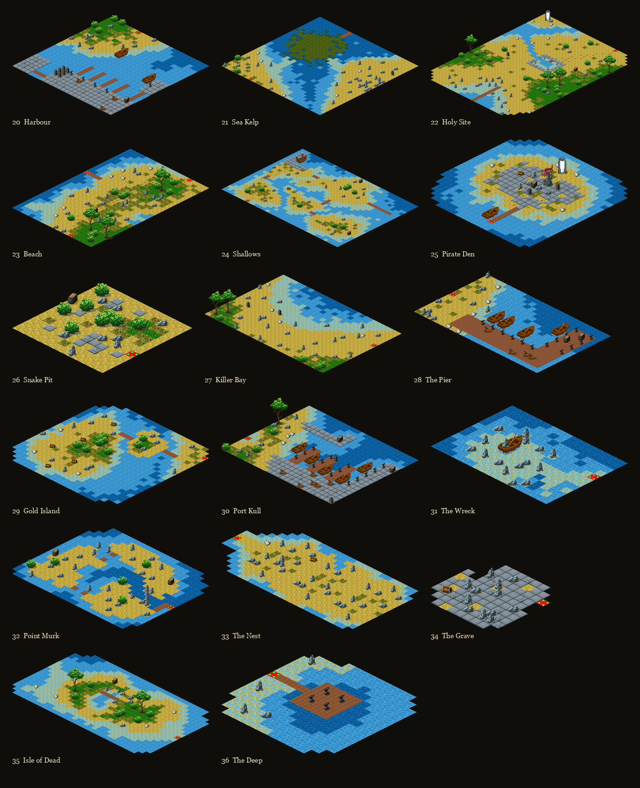

### Mistral Grove (September 2005)

Eighteen rooms of snowbound forest, and the strangest bestiary of the three:
will o' wisps, treemen, reaperweed, demon dogs, a spider, and a character
called Trix. Rooms with names like Mirror Pool, Spiderwood, Hollow Hill,
Reaperwood.

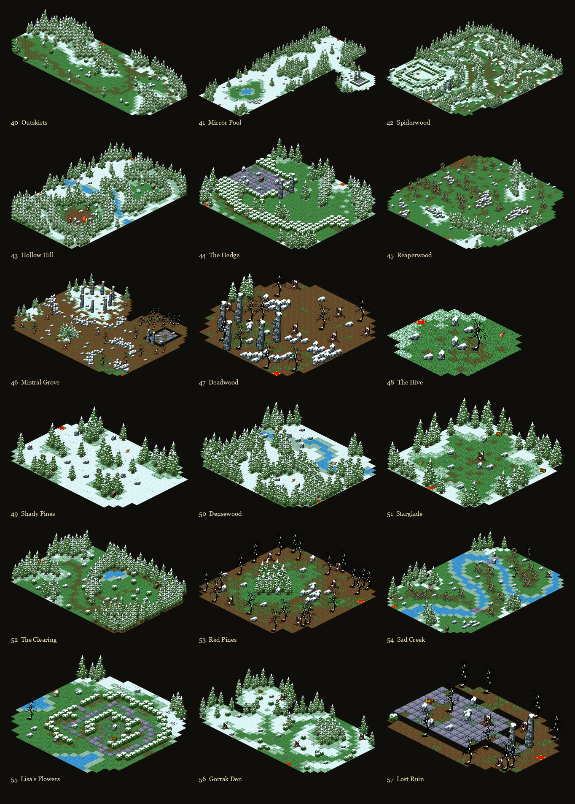

Those two are drawn as loose plates rather than a map, and that is the point:
their doorways came from the server with everything else, so **nobody knows
which room joins which**. Only Shirad's Forge can be laid out flat, because
only Shirad's Forge has its doors back.

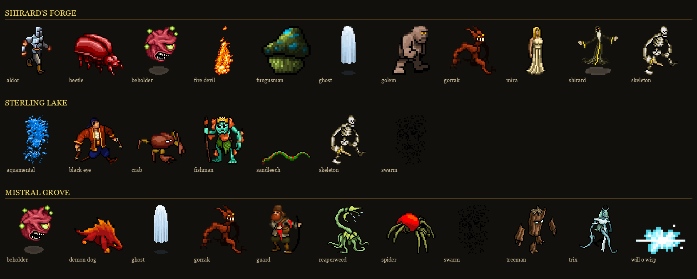

---

## The Arena: Orumant and Dagonar

Before the chapters there was the gladiator game, and it was the bigger one.

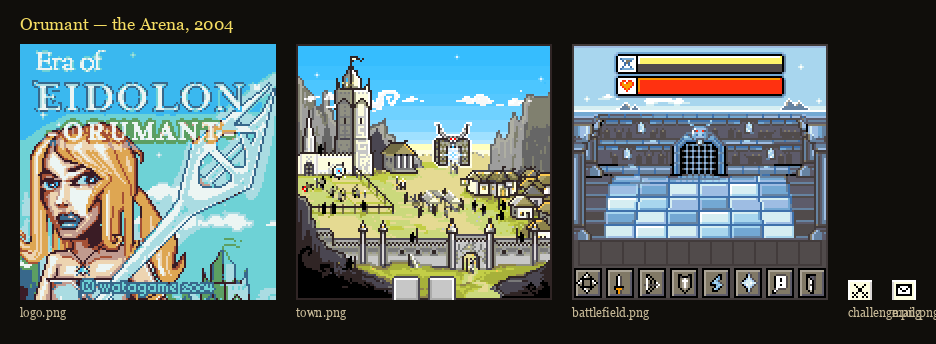

A town you walk around, an arena you fight in, a mailbox, a clan. Your
character is assembled from parts — a torso, legs, a weapon — so the armour
you buy is drawn onto you:

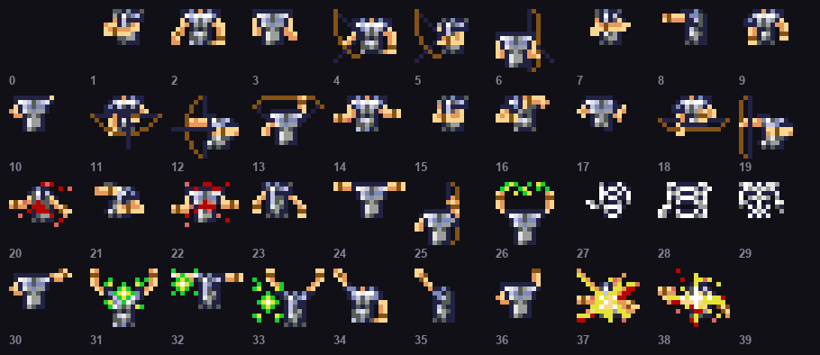

Two towns survive, Orumant and Dagonar, a year apart and sharing one server:
the sixty-four endpoints are byte-identical between them. None of it has been
rebuilt. This project has only read it.

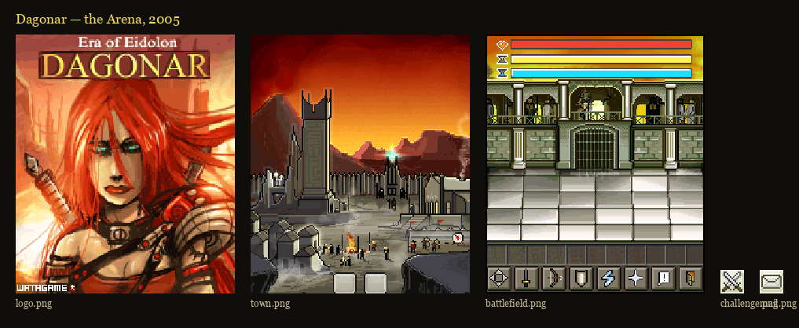

---

## The card games

watAgame also shipped two card games in 2005, under a "Badaz" label, with the
Era of Eidolon town art reused for the lobby.

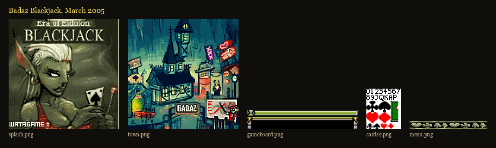

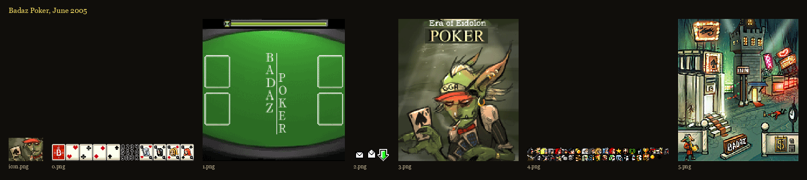

Poker's surviving jars are the ones carrying the loudest cracker tags —
*Badaz Poker by ROADKILL*, *Badaz Poker SEfan.RU*.

---

## How a fight is built

A turn is **720**. Not seconds, not frames — a budget, and every action
spends some of it.

    a step            40
    a blow            what your weapon weighs: 96 for the starting sword,
                      240 for the heaviest hammer
    a dodge           20
    a healing spell  150

So a light sword gets you five swings a turn and a hammer gets you two, and
the difference is the whole of the choice between them.

Then there is the part I did not expect. This is the client's own code:

```java
if (this.c) {                                       // in a fight
    n = (this.t - this.ax) / 1000L;                 // whole seconds elapsed
    this.ag += n * 5;                               // five units per second
    if (this.ag > 720) { this.j(); this.ag = 720; } // and the turn ends itself
}
```

**The clock you spend on walking and swinging is the same clock that empties
while you think.** Five units for every real second you sit looking at the
screen. Seven hundred and twenty divided by five is a hundred and forty-four
seconds — two minutes and twenty-four — and then the turn goes without you.

A swing of the starting sword costs ninety-six. That is the same as nineteen
seconds of deliberation. Lift the heaviest hammer and one blow costs what
forty-eight seconds of thinking costs.

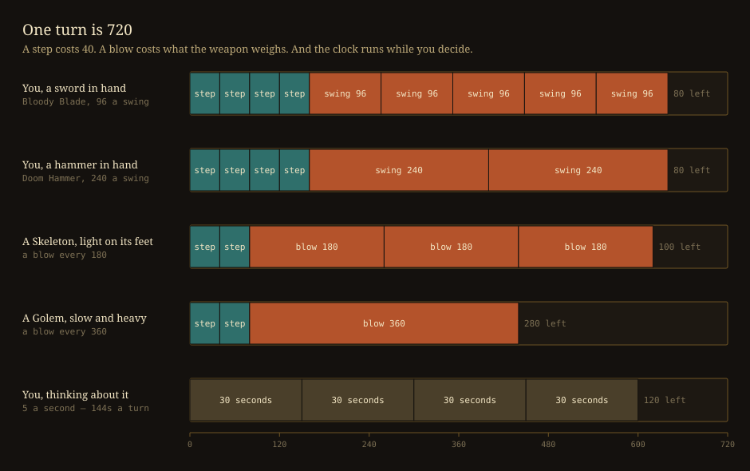

### The bar along the bottom

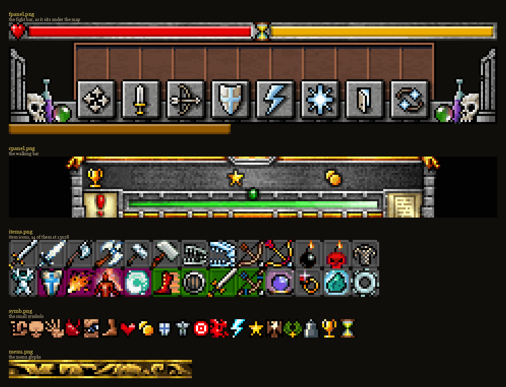

Two bars run across the top of a fight. The red one with the heart is your
life. The gold one beside the hourglass is the turn — the same 720 — draining
as you spend it, which is the only warning you get that you have been
thinking too long.

Below that, eight buttons:

    four arrows     walk           40 a square
    sword           strike         what your weapon weighs
    bow             shoot          needs a clear line, and never in contact
    shield          defend         20, and it lasts the turn
    lightning       attack magic   60, ignores armour, no roll to hit
    starburst       ward magic     40 upward, depending on the ward
    door            flee           ends the fight where you stand
    two arrows      end the turn   hand the rest of the clock back

Six of those are slots the server fills, so the exact spell in each depends
on what you have learnt. The other two are the client's own.

When you are not fighting, the bar changes: a trophy, a star, your purse, a
green sliver of experience, and the book that opens your quests.

### What you can carry

Every piece of gear is one of five kinds, and the game tells you which by the
colour behind its icon:

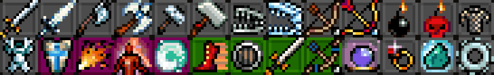

Twenty-eight icons, fourteen across and two down — swords, axes, hammers,
bows, bombs and suits along the top; then spells, skills and charms below.

The statistics behind them survive because the Arena's remake carries them:
203 entries with a time, an effect, a precision, an ability requirement and a
price. A weapon's **time** is what one swing costs of the turn, so it is the
whole of the difference between a sword and a hammer:

    Bloody Blade    sword    time  96    the one you start with
    Giant Sword     sword    time 120
    Ghost Sword     sword    time 126
    Spike Axe       axe      time 195
    Smasher         hammer   time 211
    Doom Hammer     hammer   time 240

### The quest log

Eleven in Shirad's Forge, and reading them is the fastest way to see what the
chapter actually is:

    Rescue Hrom from the Gorrak
    Find lever to extend bridge
    Seek out Mira
    Find 1st cogwheel
    Find 2nd cogwheel
    Find 3rd cogwheel
    Restore lava stream
    Defeat Shirard
    Clear the Shrine of undead
    Return gem from fire devils to Tillic
    Slay the Beholder

Eight of them are the spine. The last three — the shrine, the gem, the
beholder — are the side of the map you do not have to go to.

Both sides choose blind — you commit your whole turn, the creature commits
its whole turn, and then the two are merged and played in time order. You are
never reacting. You are predicting.

---

## Three kinds of jar

Not every copy of a chapter is the same. Sort them by what they carry and
three kinds fall out.

    thin  (MIDP 1.0)       4 resources,  0 tilemaps
    data-local            66–77 resources, 17–18 tilemaps
    fully offline         76 resources, including the world itself

The **thin** builds are for the oldest handsets. They ship four files and
download everything else as you play — the entire world, over GPRS, a room at
a time.

The **data-local** builds are the common ones. The art is in the jar; the
world still is not.

The **fully offline** build is one jar. One, out of eighteen.

There are device variants on top of that — `176x208` for Nokia's Series 60
screen, `k300` and `k700` for Sony Ericsson handsets — because in 2005 you
shipped a build per phone.

And several of the surviving jars have someone else's name in the manifest:

    Badaz Poker by ROADKILL
    Badaz Poker SEfan.RU
    EoE Dagonar -=eViL D:=-

The game survives because it was pirated. The copies that were paid for are
gone; the cracked ones are what is left.

---

## Finding the world

Two resources never shipped: the entities and the creatures. Everything else
is in the jar — tilemaps, text, sprites, animations, the quest strings — but
not one monster, not one door, not one trigger.

The only way to find them was to list the resources of all fifteen chapter
jars and look for a name nothing else had. Two turned up, in one file:

    EoE-ShiradsForge-v1.0.0-midp1.jar      63 KB    4 resources   nothing
    EoE-ShiradsForge-v1.0.0-176x208.jar   151 KB   76 resources   EVERYTHING

Same version. Same day — 29 April 2005. Two packagings of one release, and
only the one cut for Nokia's bigger screen carries the world.

    235 entities across 18 locations
    111 creature nodes

It checks out. Every entity's box falls inside its own map. Every exit's
arrival square falls inside its destination. Every creature stands on ground,
and every creature id is a sprite the jar already has. And the tilemaps of
that build are the same size, room for room, as the later one — so the tables
drop straight in.

Sterling Lake and Mistral Grove have no such build. Their worlds are
reconstructed, and everything I say about them is a guess with the arithmetic
shown.

---

## What the tables said

**The Crypt is not a small room.** You walk into a cross of 53 floor tiles
with two ghosts in it. By the end it is 147 tiles. The chambers are painted
in by tilemap patches as each wave is summoned, and the creatures standing in
them wake at the same moment. Twenty-two entities for one fight, where a
normal room has two or three.

**The doors are load boundaries.** Most sit on a map's edge and meet their
partner on the opposite edge of the next map, so the eighteen rooms tile flat
into one continuous world. The whole thing is 14,294 map cells — about
fourteen kilobytes — which would have fit in any handset of the period. It
was split for the *download*, not the memory.

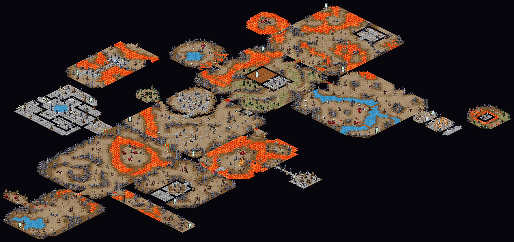

**Eleven creatures start asleep.** A `kind 5` entity switches them on:
Shirard, who does not exist until the statue falls; the Crypt's second and
third waves; and a twin standing on Mira's own square, which turns out to be
her second phase — written as a separate creature rather than a flag on the
first.

---

## Three things I got wrong

A reconstruction post that only lists the wins is not worth much. Here are
the ones that cost real time.

### The patrol box

Four bytes on each creature row, and they climb with depth. The same Beetle
reads `12, 6` in the first cave and `32, 33` in the last. That is obviously a
difficulty curve, and I built a combat system on it: damage, accuracy,
avoidance and spell resistance, all derived from those four numbers.

They are the corners of a rectangle. `x0, y0, x1, y1` — the patch of ground
the creature wanders while you explore.

What gave it away was finally running the null test. All sixty-nine creatures
that carry those bytes stand *inside* their own rectangle. A median rectangle
is a tenth of its map, and a random tile falls inside one twenty-two percent
of the time. Sixty-nine out of sixty-nine is not a coincidence at any odds
worth writing down.

The correlation with depth was real and meaningless: deeper maps are bigger,
so their coordinates are bigger.

### State 3 means gone

Having worked out that eleven creatures should start asleep, I marked them
not-alive and shipped it. The client takes a byte per creature: **1 means it
exists but is not drawn, 2 means it is on the board, 3 means it is gone.**

I was sending 3. Shirard would never have appeared, and the Crypt's waves
would never have come. The distinction is documented in the function I was
editing, three lines above the line I changed.

### Byte 11

The creature row has a byte that reads 18 for a skeleton, 24 for a gorrak,
30 for a beetle, 50 for a fungusman. Hit points, clearly — the ordering is
exactly what you would expect, and it survived months of being treated as
such, including being used as the creature's *weight* to derive how fast it
swings.

It is the respawn timer. The client reads it in three places and every one is
a countdown: a dead creature with a non-zero value is revived on load, death
copies it into a counter, and a tick decrements it until the creature comes
back. Zero means a fight that never returns. Fifty means eight minutes.

Hit points were the server's, like everything else.

That is twice I read a server-side *timing* field as a *combat stat*, with
the same confidence both times, for the same reason: the numbers were ordered
the way I expected combat numbers to be ordered.

---

## What is ours

The reconstruction is only worth something if it says where it stopped
knowing. Separated deliberately:

**The numbers.** Hit points, prices, gold, experience and the entire shop
were the server's. What survives is the Arena's item catalogue — 203 entries
with real times, effects, prices and ability requirements — and the client's
own action costs. Everything else is fitted.

**The balance.** That catalogue was written for the Arena, where a duellist
reaches level 49 and item requirements run to 78. A chapter hero clears
eighty-seven creatures and finishes somewhere around level 12, so most of the
list is unreachable. The chapter now sells a slice, respread over the range a
chapter hero actually covers.

**The fight.** Creatures threaten a *shape* rather than every square around
them — a skeleton one square ahead, a golem three, the beholder its four
corners, a fungusman four squares at arm's length and none at all beside it.
They swing at a speed set by their weight. None of this is watAgame's; their
creatures all hit the same way.

**The hero.** The rules say every ability starts at 15. That is the Arena's
number. Here they start at 3, the floor of the item ladder, so that levelling has
somewhere to go. It is the one place the rules are knowingly set aside.

---

## What is still missing

- The entities and creatures for Sterling Lake and Mistral Grove. No offline
  build of either is known to exist.
- The Arena server entirely. Sixty-four endpoints, none implemented.
- A fourth chapter, Ravarcil, which was announced and may never have shipped.
- Four entity kinds we have not decoded, covering nineteen entities.

---

*Did anyone play this?*
